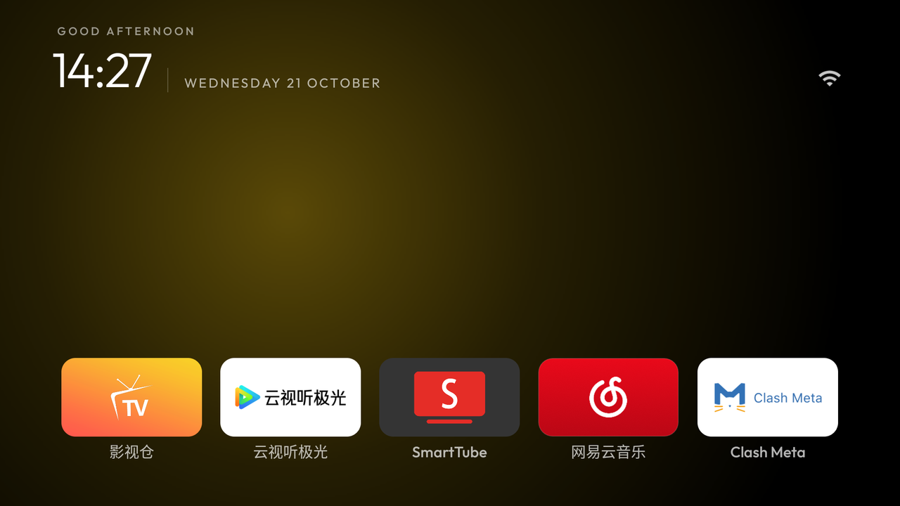
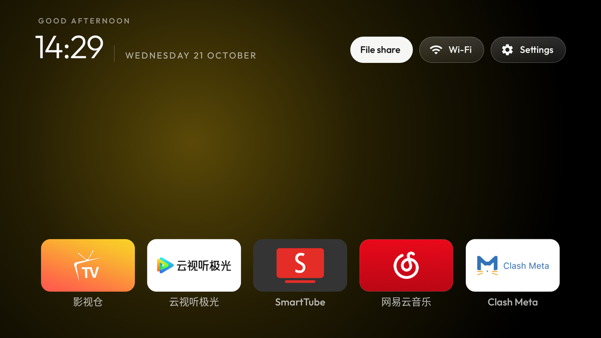
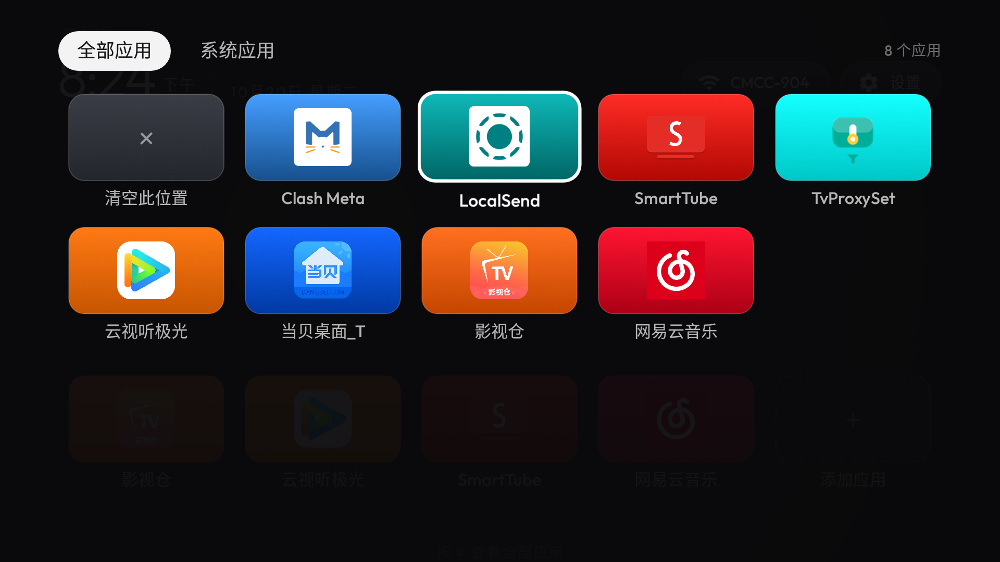
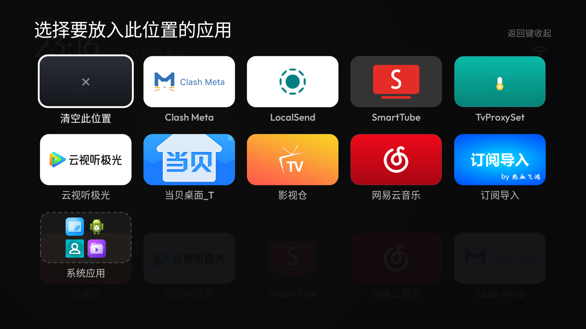
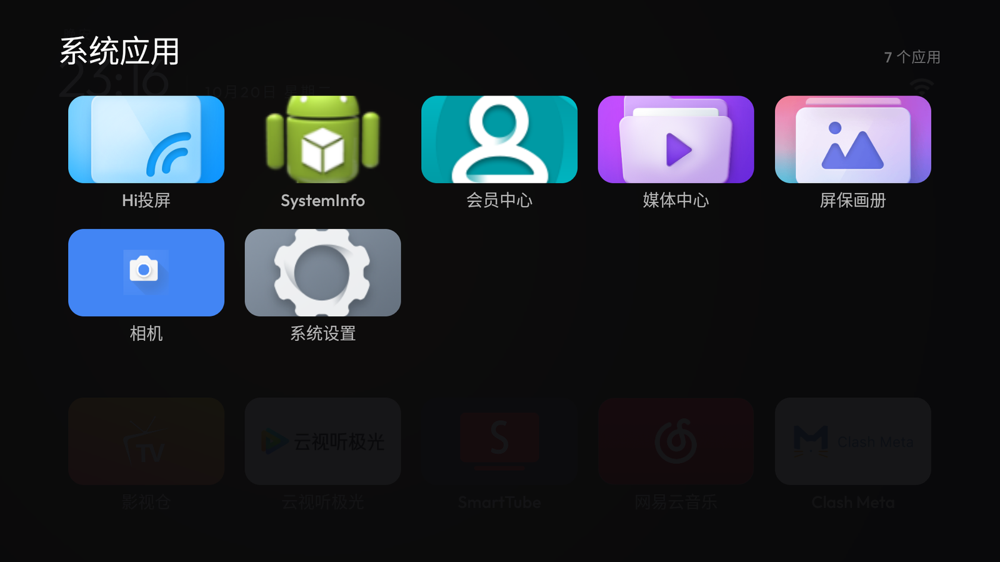
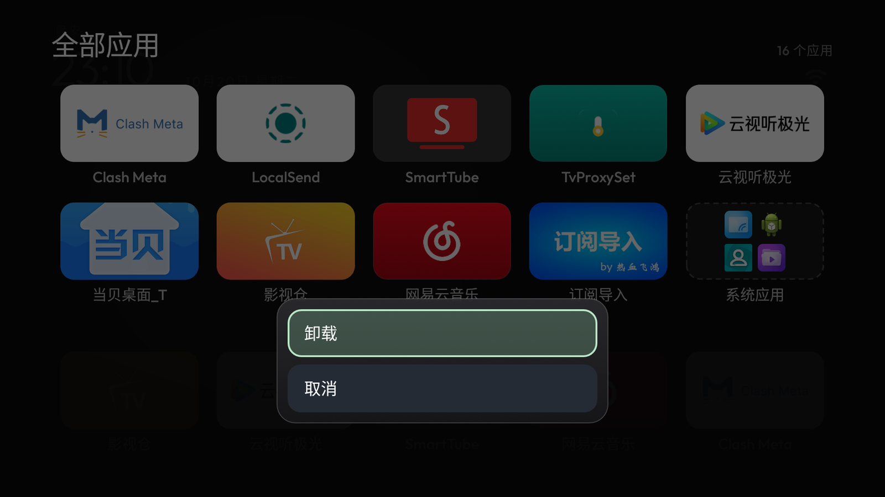
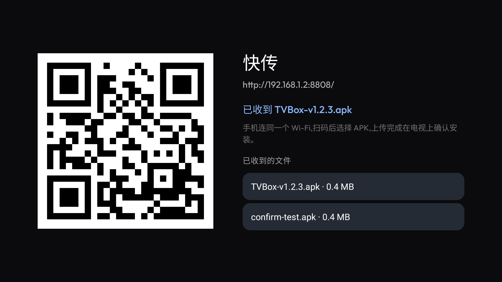

# tv-launcher

A small, fast home screen for Android TV boxes and TVs that have become slow because of their stock
launcher: no feed, no ads, no telemetry, one process, no background service.

Built for a 1.3 GB / MediaTek TV running Android 9, and kept small on purpose: **one APK under 400 KB**,
~50 MB of memory for Home, and nothing running when you are not looking at it.



<sub>Captured on a Hisense Android 9 TV at 1920×1080, from the build in this repository.</sub>

| | |
|---|---|
|  |  |
| **Up** brings out the toolbar: File share, Wi-Fi, Settings. A connection dot stays in the corner otherwise. | **Down** opens every app, five cards per row, system apps folded into one folder. |
|  |  |
| **MENU** on a slot re-opens the drawer as a picker: choose what that slot holds. | The system-apps folder, entered from the drawer. |
|  |  |
| **MENU** on an app offers Uninstall — never shown for a system app. | **File share**: scan, send an APK from a phone, install it; received files stay listed. |

## What it does

- **Shelf Home** — one row of nest slots instead of every app. Large cards, dim labels, the rest of the
  screen left empty.
- **Down opens everything** — a full-screen app drawer, five cards per row, with the system apps folded into
  one folder so they never mix with yours.
- **Pin any app to any slot** — MENU on a slot opens the same drawer in picker mode; pick an app and it
  lands in that slot. Choices are stored on the TV (`home_slots.txt`), not in the APK.
- **Up opens the toolbar** — Wi-Fi, Settings, Inputs and File share live one key away instead of on screen.
  A small connection icon stays in the corner while the toolbar is away.
- **Icons that look designed** — an app's TV banner when it ships one; otherwise the background and line-art
  foreground layers of its adaptive icon; otherwise its own background colour lifted off the icon. No boxed
  "icon inside a tile" look.
- **File share (快传)** — a QR code, a small HTTP server on the LAN, and an install prompt for whatever a
  phone uploads. Received files are listed, re-installable and deletable.
- **Uninstall from the drawer** — MENU on an app offers Uninstall; system apps do not get the entry at all.
- 24-hour clock, reduced motion mode for weak GPUs, per-app tiles removed from Home with a config change.

## Requirements

- Android 8.0+ (API 26), 32-bit ARM is enough. No native code: the same APK runs on `armeabi-v7a`,
  `arm64-v8a`, `x86` and `x86_64`.
- A remote with a D-pad. A `MENU` key gives you the extra actions; `OK` long-press does the same where the
  remote lacks one.
- English or Simplified Chinese. Nothing else is shipped; the language follows the TV's own.

## Install

```bash
adb connect <tv-ip>:5555
adb install -r tv-launcher-2.4.0-universal.apk
adb shell cmd package set-home-activity com.iam2r.tvlauncher/.MainActivity
```

On a TV this was not tuned for, the Home arrives with empty nests: press `MENU` on one, pick an app, and it
stays there. Nothing is assumed about which apps you have. If a key or a source does not work on your board,
the keys in [Configuration](#configuration) below cover the usual per-brand differences (Live TV package,
source panel service, remote Settings button by scancode or keycode).

To go back to the stock launcher:

```bash
adb shell cmd package set-home-activity <stock-launcher>/<activity>
```

## Build

```bash
export JAVA_HOME=/path/to/jdk17          # AGP 8.5 needs JDK 17
export ANDROID_HOME=/path/to/android-sdk # platform 34 + build-tools 34.0.0
./gradlew assembleRelease
adb install -r app/build/outputs/apk/release/app-release.apk
```

Continuous integration builds every push, publishes the APKs as artifacts, and attaches them to a GitHub
release for every `v*` tag. Release builds are debug-signed unless you add these repository secrets:

| Secret | Meaning |
|---|---|
| `SIGNING_KEYSTORE_BASE64` | your keystore, base64-encoded |
| `SIGNING_STORE_PASSWORD` | store password |
| `SIGNING_KEY_ALIAS` | key alias |
| `SIGNING_KEY_PASSWORD` | key password |

## Configuration

Everything lives in `app/src/main/res/values/config.xml`; a theme can override the same keys at runtime with
`config.json` in the app's external files directory.

| Key | Default | Meaning |
|---|---|---|
| `shelf_mode` | `true` here | one row of nest slots, everything else behind the Down key |
| `slot_count` | `5` | number of nests (1–8) |
| `dock_apps` | empty | what the nests hold on a fresh install; empty means "nothing until you pin it" |
| `columns` | `5` | tiles per row (classic grid mode) |
| `reduced_motion` | `true` | calmer springs and fades for weak GPUs |
| `hidden_apps` | empty | packages never shown as tiles |
| `show_stats` | `false` | CPU / memory / storage line under the clock |

## Licence and credits

MIT — see [LICENSE](LICENSE).

The launcher bundles the Outfit font (SIL Open Font License, see `FONT-LICENSE-OFL.txt`) and uses ZXing
core (Apache-2.0) to draw the file-share QR code.
